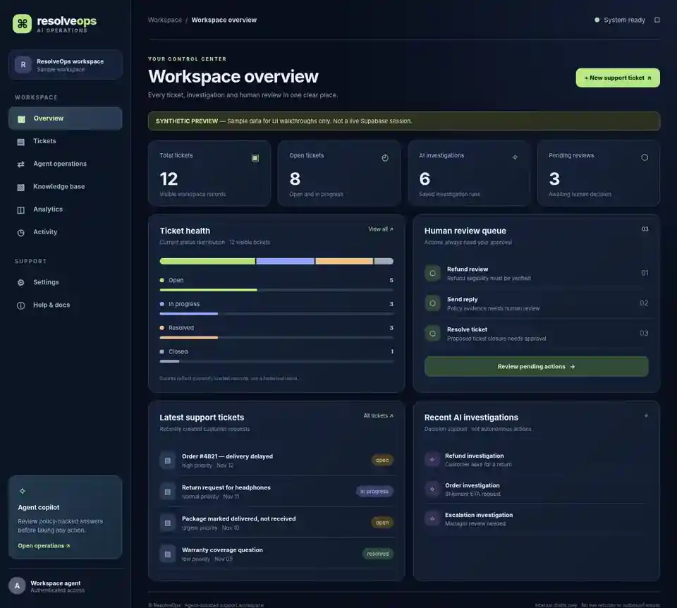
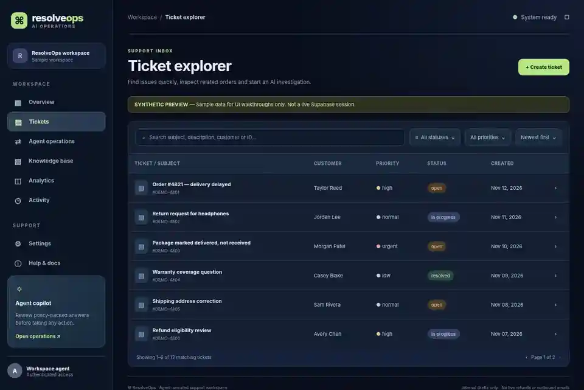
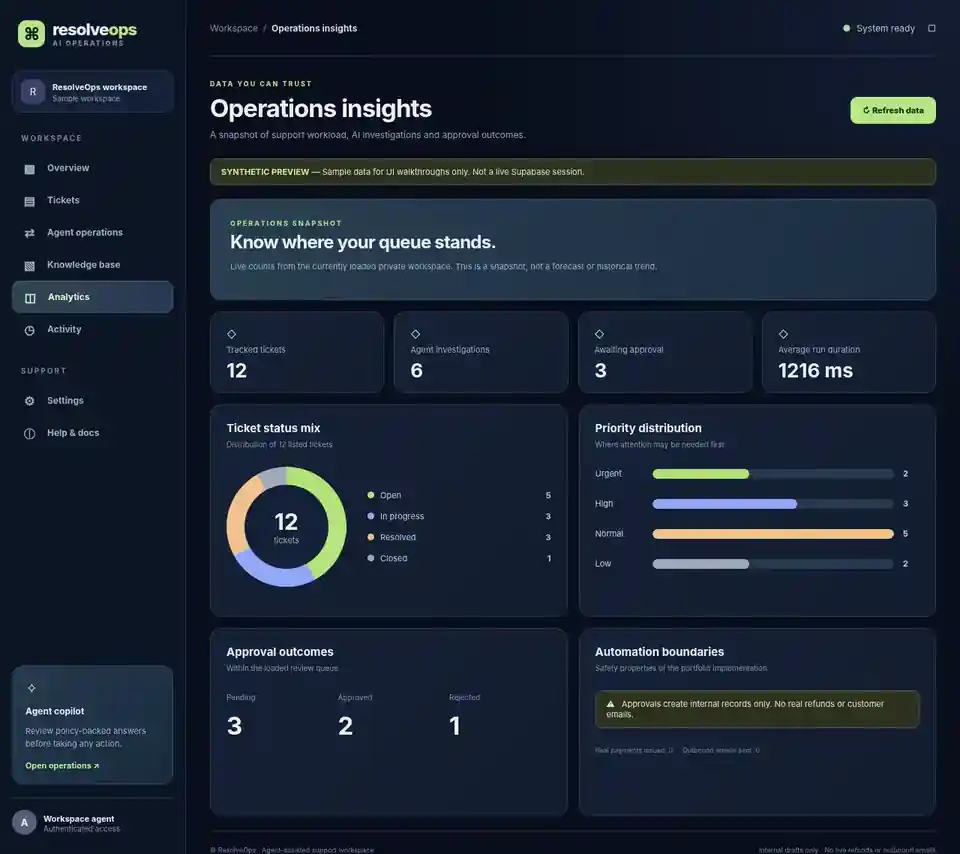

# ResolveOps — AI Support & Order Resolution

A full-stack portfolio project for assisted customer support: **Next.js 16 + FastAPI + LangChain/Gemini + LangGraph + Supabase Auth/Postgres + pgvector**. It demonstrates policy-grounded investigations and explicit human approval before internal support actions.

**Project status:** Phases **1–6 coded**. Phase 7 production hardening and live end-to-end verification remain. Real refunds and outbound customer emails are **not implemented**.

## Phase 6 — Dashboard and UI

The new interface has a responsive dark workspace shell, useful empty/loading/error states, customer ticket search and filtering, owner-scoped analytics, review-aware activity, and an interactive sample showcase.

| Page | Purpose |
| --- | --- |
| `/showcase` | Public synthetic-data overview preview (no credentials) |
| `/showcase/tickets` | Public interactive ticket explorer preview |
| `/showcase/insights` | Public sample analytics preview |
| `/login` | Supabase email/password authentication |
| `/dashboard` | Authenticated support KPIs and recent activity |
| `/tickets` | Authenticated search, status/priority filters, sorting, detail drawer |
| `/workspace` | Customer, order, ticket and internal note CRUD |
| `/knowledge` | Upload and query grounded policy knowledge |
| `/operations` | LangGraph investigation, review queue and audit |
| `/insights` | Snapshot charts for tickets, priority and approval decisions |
| `/activity` | Recent owner-scoped investigation and decision timeline |
| `/docs` | In-app workflow guidance |

### Screenshot previews (synthetic sample data)

These are screenshots of the **static Phase 6 design preview**. They do not show a live connected Supabase account. See the [complete step-by-step walkthrough](docs/screenshots/README.md) and the actual `/showcase` routes.

**1. Workspace overview**



**2. Searchable ticket explorer**



**3. Operations analytics**



## Start locally

Clone the repository and open it in VS Code.

```powershell
git clone https://github.com/Ali-Khoso/resolveops-ai-agent.git
cd resolveops-ai-agent
code .
```

**Backend:** Python 3.11+ in `backend/`.

```powershell
py -3.11 -m venv .venv
.\.venv\Scripts\Activate.ps1
pip install -r requirements.txt
Copy-Item .env.example .env
python -m pytest -q
python -m uvicorn app.main:app --reload
```

**Frontend:** Node.js 22+ in `frontend/` (separate terminal).

```powershell
Copy-Item .env.example .env.local
npm install
npm run phase6:check
npm run lint
npm run build
npm run dev
```

Open [http://localhost:3000/showcase](http://localhost:3000/showcase) for an immediate preview without a cloud account.

For private features, configure `SUPABASE_URL`, `SUPABASE_PUBLISHABLE_KEY` and `GOOGLE_API_KEY` in the backend environment, with matching public `NEXT_PUBLIC_*` values in the frontend. Use only your own test accounts and synthetic data. Follow [Phase 4–7 credentials/setup](docs/PHASE4_7_SETUP.md), [Phase 5 approval setup](docs/PHASE5_APPROVALS.md) and [Phase 6 walkthrough](docs/PHASE6_SETUP.md). Apply all five SQL migrations in `supabase/migrations/` in order.

The backend API docs are available at `http://127.0.0.1:8000/docs`.

## Architecture and safety

- Authentication: Supabase validates end-user JWTs; PostgREST forwards them to enforce row-level security (RLS).
- Knowledge: PDF/text policies are chunked, embedded, retrieved with pgvector, and answered with citations.
- Agent: LangGraph classifies support requests and retrieves owned ticket/order data; high-risk actions are internal drafts requiring human review.
- Human approval: Approved internal replies create ticket notes; ticket resolution changes local ticket status; refund reviews record a decision **only**.
- Dashboard: Authenticated pages show currently loaded records. Capped list responses are not full historical aggregates.
- Public showcase: Deterministic synthetic data, no private API requests or secrets.
- Offline testing/CI is present, but live production authorization and resilience have not been certified.

## Documentation

- [Architecture](docs/ARCHITECTURE.md)
- [Development roadmap and remaining Phase 7](docs/ROADMAP.md)
- [Phase 4 workflow guardrails](docs/PHASE4_WORKFLOWS.md)
- [Phase 5 internal approvals](docs/PHASE5_APPROVALS.md)
- [Phase 6 pages and user steps](docs/PHASE6_SETUP.md)
- [Phase 6 screenshots](docs/screenshots/README.md)

**License:** MIT. Do not use real private customer information until the service has received a full production security assessment.
