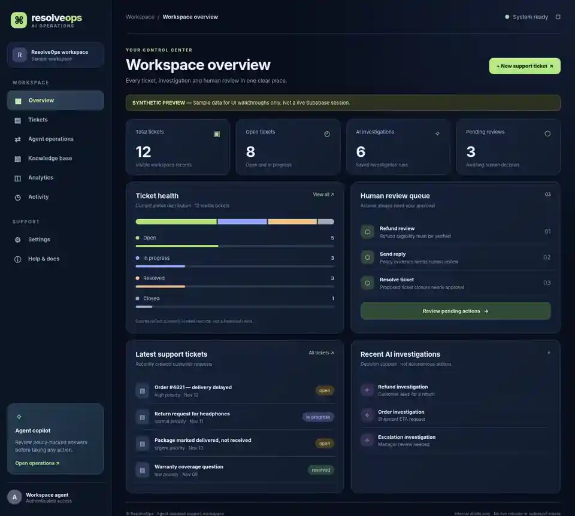
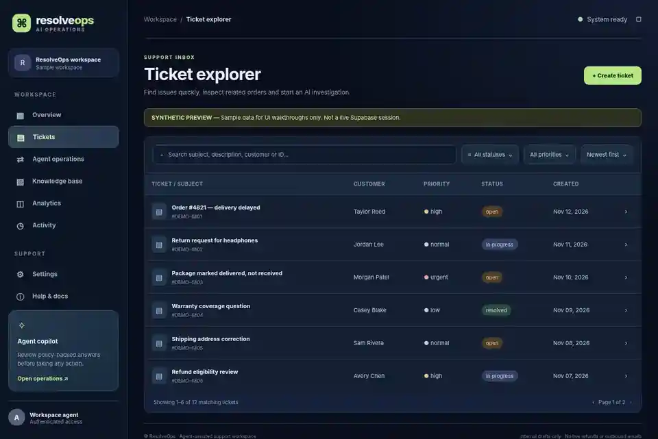
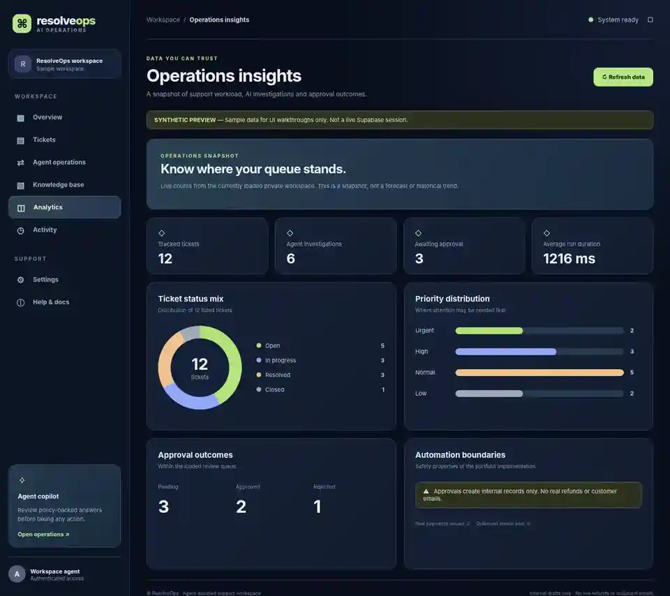

# Phase 6 — UI screenshots and step-by-step walkthrough

**Image provenance:** These images are browser screenshots rendered locally from
`phase6-ui-preview.html`, the included static design preview. All displayed
ticket, customer, analytics, and approval values are **synthetic**.
They are visual references of the Phase 6 design, **not** screenshots of a
live authenticated Supabase workspace.

The running Next.js implementation also exposes public sample-data showcase
routes that reuse the Phase 6 React components.

## Step 1 — Explore the dashboard

- Open `http://localhost:3000/showcase` without credentials.
- Observe tickets, current ticket health, pending approvals and AI runs.
- Sign in and visit `/dashboard` to see your own account-scoped data.
- The totals are based on loaded records; no historical growth is implied.

## Step 2 — Search and filter tickets

- Open `http://localhost:3000/showcase/tickets`.
- Use search to find a subject, ticket ID, description or customer name.
- Filter status and priority; sort by newest, oldest or priority.
- Open a ticket row for its details and linked order, or use pagination.
- Sign in and visit `/tickets` for real authorized workspace records.

## Step 3 — Review insights and boundaries

- Open `http://localhost:3000/showcase/insights`.
- Review status, priority, and approval-outcome distributions.
- Visit `/insights` signed in for actual current account data.
- The dashboard does not issue refunds or customer emails.

## Step 4 — Work through an end-to-end support case

1. Sign in at `/login` with a configured Supabase account.
2. Open `/workspace` to create a synthetic customer, order and ticket.
3. Open `/knowledge` to upload a text-based policy document.
4. Use `/operations` to run a LangGraph investigation and inspect sources.
5. Submit an approval request, approve/reject with notes, then check audit history.
6. Check `/activity` to see investigation and review events.

## Setup and reproduction

- Read `docs/PHASE4_7_SETUP.md` and `docs/PHASE5_APPROVALS.md`.
- Apply all Phase 2–5 SQL migrations before authenticated workflow tests.
- Run `npm install && npm run dev` inside `frontend/`.
- For a static visual preview without installing dependencies, open
  `docs/screenshots/phase6-ui-preview.html` in a browser. It uses only local HTML,
  CSS and JavaScript and has no network access or private customer data.
- To reproduce the three screenshots with Playwright, use a Chromium viewport
  of 1280 × 850 and the preview's `?view=overview`,
  `?view=tickets` or `?view=insights` parameter, then capture the page.
- Never publish screenshots containing access tokens, email addresses of real
  customers or private knowledge content.

The images in this directory are reference previews. Verify the signed-in UI
with a real configured test account separately before a production release.
